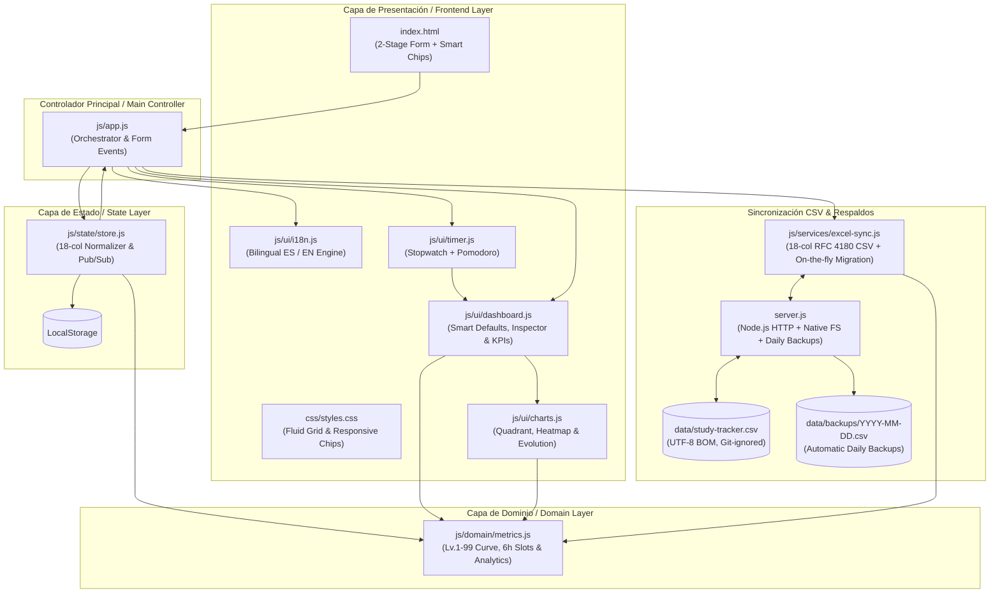

# ⚔️ StudyTracker v3 — Local-First Analytics & CSV Sync

> 🌐 **Idioma / Language:** [🇪🇸 Español](#-español) | [🇬🇧 English](#-english)  
> 📚 **Documentación / Docs:** [📐 Decisiones & Versiones](docs/DECISIONES.md) · [❓ Preguntas Guía](docs/PREGUNTAS.md) · [💡 Ideas y Roadmap](docs/IDEAS.md) · [🗺️ Ruta v3](docs/ruta_refactorizaci%C3%B3n.md)

---

## 🇪🇸 Español

Aplicación web **Local-First** gamificada (estilo RPG) ultra-ligera con **micro-servidor local en Node.js** (y soporte directo por navegador vía *File System Access API*) para registrar, editar y eliminar bloques de estudio sin fatiga de decisión, evaluar hábitos cognitivos y sincronizar los datos en tiempo real directamente sobre un archivo CSV local (`data/study-tracker.csv`) con **respaldos automáticos diarios** (`data/backups/YYYY-MM-DD.csv`).

### ✨ Características Principales (v3.0)

- **Curva Exponencial de Nivel RPG (*"Level 92 is half of 99"*):**
  - Inspirada en *Old School RuneScape*, la experiencia requerida **se duplica cada 7 niveles**:
    $$\text{XP}(\text{Nivel } L) = \text{REDONDEAR}\Big( 250 \times \left(2^{(L-1)/7} - 1\right) \Big)$$
  - Subida rápida en los primeros niveles para motivar la constancia, progresión creciente (+10.4% por nivel) y propiedad matemática exacta donde el **Nivel 92 representa el 50% del XP total hacia el Nivel 99**.
- **Formulario en 2 Etapas Cognitivas + Pre-llenado Inteligente (*Smart Defaults*):**
  - **🎯 Etapa 1: Punto de Partida (Al Iniciar):** Pre-llena automáticamente la última materia, contexto, actividad y energía habitual para la franja horaria actual. Incluye **Chips Rápidos de Materias Recientes** (1 clic para elegir materia o `[+ Nueva]`).
  - **🏁 Etapa 2: Evaluación del Bloque (Al Terminar):** Evalúa la Dinámica Cognitiva, el `% IA`, la Fluidez del bloque, la Asimilación (1–5) y las Notas con `[Subtema]`.
- **Taxonomía Ortogonal v3 (`4 Contextos` × `6 Actividades` × `4 Dinámicas Cognitivas` × `3 Niveles de Dominio Previo`):**
  - **Contexto / Propósito (4 chips):**
    - `🎓 Académico`: Materias universitarias/escolares, tareas y exámenes de carrera.
    - `🏅 Certificación`: Certificaciones profesionales (ej. *Snowflake*) y cursos técnicos estructurados.
    - `🚀 Proyecto Propio`: Desarrollo de software personal, portafolio o proyectos en pareja.
    - `🤝 Externo`: Proyectos de amigos/terceros (ej. *Ruby on Rails*), incluyendo el estudio requerido para ellos.
  - **La Prueba Objetiva de Dominio Previo (`Dominio_Previo` — Cero dudas):**
    - `🌱 Nuevo` *(0 contactos previos)*: Nunca has estudiado este concepto/herramienta específica. Si te pidieran explicarlo o escribir código ahorita mismo, no sabrías por dónde empezar.
    - `🌿 En construcción` *(Necesitas apoyo/consulta)*: Ya lo viste antes (en clase, ayer o en el Pomodoro pasado), pero todavía necesitas mirar tus apuntes, la documentación o apoyarte en la IA para avanzar sin trabarte.
    - `🌳 Consolidado` *(Autónomo)*: Puedes explicarlo, resolver problemas o programar sobre esto sin mirar el manual ni depender de la IA, o solo estás haciendo un bloque de repaso/mantenimiento veloz.
  - **Dinámica Cognitiva Unificada (`Dinamica_Cognitiva` — ¿Cómo trabajaste y qué rol jugó la IA?):**
    - `👀 Recepción Pasiva (0% ajuste XP)`: Leer, escuchar clase o ver un video sin producir ni debatir activamente aún.
    - `🤖 Delegación / Reproducción (-15% XP si IA ≥50%)`: La IA o la fuente hizo el trabajo pesado y tú solo copiaste, transcribiste o seguiste pasos sin construirlo desde tu mente.
    - `🔄 Andamiaje / Co-creación (+5% XP)`: Pensaste con apoyo; usaste la IA como tutor socrático (debatiendo el *"¿por qué?"*), copiloto de sintaxis o estructurador de tus propias ideas.
    - `🧠 Generación Propia (+10% XP con 0% IA · +5% con consulta mínima)`: El esfuerzo mental pesado salió de tu cabeza (redactar con tus palabras, resolver o programar con tu propia lógica).
  - **Tipo de Actividad (6 chips ortogonales con ayuda dinámica en vivo):**

| Actividad | ¿Qué significa y cuándo usarla? | ¿Cómo no confundirla con otras? |
| :--- | :--- | :--- |
| **`👨‍🏫 Clase / Cátedra`** | **En vivo con un profesor o ponente:** asistir a una clase escolar, cátedra universitaria o taller guiado. Evalúa tu **concentración, interés y retención**. | Aquí el ritmo lo lleva un **profesor en vivo**. Si estudias por tu cuenta a tu ritmo, usa `📖 Estudio Teórico / Conceptual`. |
| **`📖 Estudio Teórico / Conceptual`** | **Comprender el *qué* o el *porqué*:** leer documentación oficial (ej. *Snowflake Docs*), libros, papers, ver videocursos grabados o debatir conceptos teóricos con IA. | Se enfoca en **comprender conceptos o investigar teoría** antes de pasar a redactar apuntes propios (`✍️ Síntesis`) o programar (`💻 Desarrollo`). |
| **`✍️ Síntesis / Documentación`** | **Traducir y estructurar en un artefacto propio:** redactar apuntes o *cheatsheets* (en cuaderno o PC), resúmenes, mapas mentales o diagramas de arquitectura. | Mientras que en `📖 Estudio Teórico` consumes/exploras conceptos, aquí **produces síntesis o diseño tangible** sin escribir código todavía. |
| **`💻 Desarrollo / Código`** | **Construir e implementar:** escribir código nuevo, consultas SQL, scripts o desarrollar funcionalidades de un proyecto o entregable. | Es **creación de software/entregables**. Si estás cazando un error o resolviendo ejercicios aislados, usa `🧪 Práctica / Debugging`. |
| **`🧪 Práctica / Debugging`** | **Ejercitar o destrabar errores:** hacer laboratorios prácticos, ejercicios tipo kata/algoritmos o depurar (*debugging*) un bug hasta encontrar la causa. | Se enfoca en **entrenar destreza o arreglar fallos**, no en levantar funcionalidades nuevas desde cero (`💻 Desarrollo`). |
| **`🔁 Repaso / Simulacro`** | **Consolidar memoria sobre algo ya visto:** repasar tus propios apuntes previos, flashcards, explicar un tema sin mirar o hacer exámenes de simulacro (*mock exams*). | Solo aplica a temas que **ya estudiaste antes** y estás reforzando para no olvidarlos o para medirte antes de un examen. |

- **Franjas Horarias Circadianas Simétricas de 6 Horas:**
  - `00:00–05:59` → `Madrugada`
  - `06:00–11:59` → `Mañana`
  - `12:00–17:59` → `Tarde`
  - `18:00–23:59` → `Noche`
- **Etiquetas de Subtema en Notas (`[Subtema] Nota`):**
  - Escribe `[Subtema]` al inicio de tus notas (ej. `[Mesa Redonda - GANs] Debate de arquitectura`) para agrupar automáticamente tus sesiones en el **Inspector de Subtemas** sin añadir campos obligatorios extra al formulario.
- **Diseño Responsivo con Grid Fluido y Text Wrap:**
  - Los grupos de chips utilizan `grid-template-columns: repeat(auto-fit, minmax(150px, 1fr))` y ajuste de línea automático para garantizar **cero desbordamientos horizontales** en tarjetas y pantallas estrechas.
- **Sincronización en Tiempo Real con CSV (`data/study-tracker.csv`) y Respaldos Automáticos:**
  - **Modo 1 (Servidor Local `server.js`):** Cada alta, edición (`✏️`) o eliminación (`✖`) actualiza directamente `data/study-tracker.csv` (`UTF-8 con BOM`) y crea un respaldo diario automático en `data/backups/YYYY-MM-DD.csv` antes de sobrescribir.
  - **Modo 2 (100% Navegador sin servidor):** Puedes vincular cualquier `.csv` local usando la *File System Access API* del navegador.
  - Migración automática transparente si cargas un archivo CSV antiguo de 20 columnas (v2) al nuevo esquema canónico de 18 columnas (v3).

### 🏗️ Arquitectura del Proyecto (v3.0)

### 🧮 Esquema de 18 Columnas en CSV (`data/study-tracker.csv`) y Fórmulas en JavaScript

El archivo `data/study-tracker.csv` se guarda en texto plano `UTF-8 con BOM` (estándar RFC 4180) con las siguientes **18 columnas**:

`Fecha,Dia_Semana,Hora_Inicio,Hora_Fin,Franja_Horaria,Contexto,Materia,Tipo_Actividad,Dinamica_Cognitiva,Uso_IA_Porcentaje,Dominio_Previo,Energia_Previa,Complejidad,Objetivo_Cumplido,Duracion_Minutos,Calidad,XP_Ganados,Notas`

| Métrica | Regla / Fórmula en JavaScript (`js/domain/metrics.js`) |
| :--- | :--- |
| **Duración (min)** | Diferencia entre `Hora_Fin` y `Hora_Inicio` (soporta cruce de medianoche sumando `1440` min). |
| **XP Ganados** | $\text{REDONDEAR}\Big(\text{Duración} \times \max(0.5,\ 1 + \text{Calidad}\times 0.2 + \text{BonoReto} + \text{BonoMeta} + \text{BonoDinamica})\Big)$ |
| **Nivel Exponencial (1-99)** | $\text{XP}(L) = \text{REDONDEAR}\big(250 \times (2^{(L-1)/7} - 1)\big)$ *(Nivel 92 = 50% de 99)* |
| **Franja Horaria** | `00:00–05:59 Madrugada` · `06:00–11:59 Mañana` · `12:00–17:59 Tarde` · `18:00–23:59 Noche` |
| **Bono Dinámica** | `Generación Propia (+10%)` · `Andamiaje (+5%)` · `Recepción Pasiva (0%)` · `Delegación (-15% si IA ≥ 50%)` |

### 🚀 Cómo Iniciar el Proyecto

No requiere instalar paquetes externos (`node_modules`), ya que tanto el frontend como `server.js` usan código nativo:

1. Haz doble clic en **`start.bat`** (o ejecuta `npm start` / `node server.js` en la terminal).
2. Se abrirá automáticamente `http://localhost:3000`.
3. El indicador superior mostrará **`🟢 Sincronizado en vivo: data/study-tracker.csv`**.
4. Cada sesión que registres, edites (`✏️`) o elimines (`✖`) actualizará instantáneamente el archivo `data/study-tracker.csv` y generará un respaldo diario en `data/backups/`.

---

## 🇬🇧 English

An ultra-lightweight gamified **Local-First** web application (RPG-style) powered by a **zero-dependency Node.js micro-server** (plus direct browser *File System Access API* support) to log, edit, and delete study blocks without decision fatigue, evaluate cognitive habits, and sync your data in real time directly onto a local CSV file (`data/study-tracker.csv`) with **automatic daily backups** (`data/backups/YYYY-MM-DD.csv`).

### ✨ Key Features (v3.0)

- **Exponential RPG Level Curve (*"Level 92 is half of 99"*):**
  - Inspired by *Old School RuneScape*, required experience **doubles every 7 levels**:
    $$\text{XP}(\text{Level } L) = \text{ROUND}\Big( 250 \times \left(2^{(L-1)/7} - 1\right) \Big)$$
  - Fast early leveling to reward consistency, progressive scaling (+10.4% per level), and the exact mathematical property where **Level 92 equals 50% of the total XP required for Level 99**.
- **2-Stage Cognitive Form + Smart Defaults:**
  - **🎯 Stage 1: Starting Point (At Start):** Auto-prefills your latest subject, context, activity, and typical energy for the current time slot. Includes **Recent Subject Quick-Chips** (1 click to pick a subject or `[+ New]`).
  - **🏁 Stage 2: Block Evaluation (At End):** Rate the Cognitive Dynamic, `% AI`, Block Fluency, Assimilation (1–5), and Notes with `[Subtopic]`.
- **v3 Orthogonal Taxonomy (`4 Contexts` × `6 Activities` × `4 Cognitive Dynamics` × `3 Objective Prior Mastery Levels`):**
  - **The Objective Prior Mastery Test (`Dominio_Previo`):**
    - `🌱 New` (`Nuevo` — *0 prior contacts*): You have never studied this specific concept/tool. If asked to explain it or write code right now, you wouldn't know where to start.
    - `🌿 In progress` (`En construcción` — *Needs support/lookup*): You saw it before (in class, yesterday, or last Pomodoro), but still need notes, docs, or AI to progress without getting stuck.
    - `🌳 Consolidated` (`Consolidado` — *Autonomous*): You can explain it, solve problems, or code without looking at the manual or relying on AI, or you are doing a fast review/maintenance block.
  - **Unified Cognitive Dynamic (`Dinamica_Cognitiva` — How did you work & what role did AI play?):**
    - `👀 Passive Reception` (`Recepción Pasiva` — `0% XP adj.`): Reading, listening to a lecture, or watching a video without actively producing or debating yet.
    - `🤖 Delegation / Reproduction` (`Delegación / Reproducción` — `-15% XP if AI ≥50%`): AI or the source did the heavy lifting and you copied, transcribed, or followed steps mechanically.
    - `🔄 Scaffolding / Co-creation` (`Andamiaje / Co-creación` — `+5% XP`): You thought with support; used AI as a Socratic tutor, syntax copilot, or structurer of your own ideas.
    - `🧠 Own Generation` (`Generación Propia` — `+10% XP at 0% AI · +5% with minor lookup`): The heavy mental effort came from your own head.
  - **6 Clean Activity Types (`Tipo_Actividad`):**
    - `👨‍🏫 Class / Lecture` (`Clase / Cátedra`)
    - `📖 Theoretical / Conceptual Study` (`Estudio Teórico / Conceptual`)
    - `✍️ Synthesis / Documentation` (`Síntesis / Documentación`)
    - `💻 Dev / Code` (`Desarrollo / Código`)
    - `🧪 Practice / Debug` (`Práctica / Debugging`)
    - `🔁 Review / Mock` (`Repaso / Simulacro`)
- **6-Hour Circadian Time Slots:**
  - `00:00–05:59` → `Early Morning` (`Madrugada`)
  - `06:00–11:59` → `Morning` (`Mañana`)
  - `12:00–17:59` → `Afternoon` (`Tarde`)
  - `18:00–23:59` → `Night` (`Noche`)
- **Fluid Grid & Text Wrap (Zero Horizontal Overflow):**
  - Chip groups use `repeat(auto-fit, minmax(150px, 1fr))` with natural wrapping to fit cards cleanly across all screen sizes.

### 🧮 18-Column CSV Schema (`data/study-tracker.csv`) & JavaScript Formulas

The generated `data/study-tracker.csv` file is stored in plain-text `UTF-8 with BOM` (RFC 4180 standard) with the following **18 columns**:

`Fecha,Dia_Semana,Hora_Inicio,Hora_Fin,Franja_Horaria,Contexto,Materia,Tipo_Actividad,Dinamica_Cognitiva,Uso_IA_Porcentaje,Dominio_Previo,Energia_Previa,Complejidad,Objetivo_Cumplido,Duracion_Minutos,Calidad,XP_Ganados,Notas`

| Metric | Rule / Formula in JavaScript (`js/domain/metrics.js`) |
| :--- | :--- |
| **Duration (min)** | Difference between `Hora_Fin` and `Hora_Inicio` (supports midnight crossover by adding `1440` min). |
| **XP Earned** | $\text{ROUND}\Big(\text{Duration} \times \max(0.5,\ 1 + \text{Quality}\times 0.2 + \text{ChallengeBonus} + \text{GoalBonus} + \text{DynamicBonus})\Big)$ |
| **Exponential Level (1-99)** | $\text{XP}(L) = \text{ROUND}\big(250 \times (2^{(L-1)/7} - 1)\big)$ *(Level 92 = 50% of 99)* |
| **Circadian Slots** | `00:00–05:59 Early Morning` · `06:00–11:59 Morning` · `12:00–17:59 Afternoon` · `18:00–23:59 Night` |

### 🚀 Getting Started

No external `node_modules` installation is required:

1. Double-click **`start.bat`** (or run `npm start` / `node server.js` in your terminal).
2. `http://localhost:3000` will open automatically in your browser.
3. The top status pill will display **`🟢 Live synced: data/study-tracker.csv`**.
