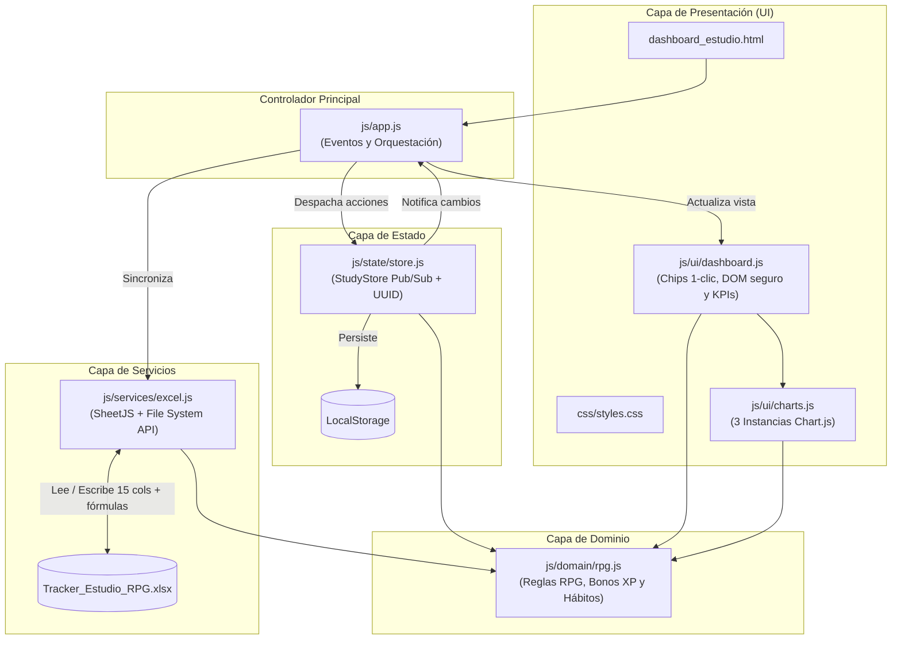

# ⚔️ StudyTracker RPG — Dashboard Local de Estudio

Aplicación web **Local-First** gamificada (estilo RPG) para registrar bloques de estudio, medir la calidad de concentración, evaluar tus hábitos cognitivos, analizar la autonomía frente al uso de IA y sincronizar los datos con hojas de cálculo de Excel (`.xlsx`) que incluyen fórmulas reales autocalculables.

---

## ✨ Características Principales

- **Gamificación RPG con Bonos de Esfuerzo:** Cálculo automático de puntos de experiencia (`XP`) considerando duración, calidad (1-5), complejidad del tema (`+10%` desafiante, `+20%` muy difícil) y cumplimiento de objetivo (`+10%`). Subida de nivel cada `500 XP` y evolución de rangos (*Novato del Enfoque* → *Señor del Flujo Profundo*).
- **Captura de Hábitos de Baja Fricción (1 Clic + Campos Automáticos):**
  - **Selectores rápidos (Chips):** *Tipo de Actividad* (`💻 Código`, `📖 Lectura`, `✍️ Papel / A mano`, `📝 Tarea / Entrega`, `🔁 Repaso`), *Energía Previa* (`🔋 Alta`, `⚡ Media`, `🪫 Baja`), *Complejidad* (`🟢 Fácil`, `🟡 Desafiante`, `🔴 Muy difícil`) y *Objetivo Cumplido* (`✅ Sí`, `⚠️ Parcial`, `❌ No`).
  - **Enriquecimiento automático (0 fricción):** Cálculo transparente de `Dia_Semana` y `Franja_Horaria` (*Madrugada*, *Mañana*, *Tarde*, *Noche*) a partir de la fecha y hora de inicio.
- **Analítica Biológica, Académica y de Hábitos:**
  - Gráfico combinado (Barras + Línea) para identificar tus **horas pico de concentración** a lo largo del día.
  - Gráfico comparativo por materia entre **tiempo invertido** y **porcentaje de dependencia de IA**.
  - Panel de **Patrones de Hábito**: minutos y calidad promedio por *Tipo de Actividad*, más indicadores de rendimiento según tu *Energía Previa*.
- **Sincronización con Excel (`.xlsx`):**
  - Exportación de libros `.xlsx` (15 columnas analíticas) con **fórmulas nativas de Excel** inyectadas en cada fila y una segunda pestaña de resumen y guía.
  - Importación retrocompatible desde archivos `.xlsx`, `.xls` o `.csv`.
  - **Vinculación en vivo** mediante *File System Access API* (en navegadores Chromium sobre contexto seguro) para sobreescribir automáticamente el archivo local.

---

## 🏗️ Arquitectura del Proyecto

El proyecto sigue una **arquitectura modular en capas** con un contenedor de estado centralizado (**Patrón Store / Pub-Sub**), diseñada para funcionar tanto abriendo el archivo directamente (`file://`) como desde un servidor local (`http://localhost`).



### 📂 Estructura de Directorios

```text
tracker_estudio/
├── dashboard_estudio.html       # Punto de entrada HTML semántico
├── Tracker_Estudio_RPG.xlsx     # Archivo Excel local con historial y fórmulas
├── README.md                    # Documentación del proyecto y arquitectura
├── css/
│   └── styles.css               # Variables de tema, chips de 1 clic y layout responsive
└── js/
    ├── domain/
    │   └── rpg.js               # Reglas de negocio puras (minutos, XP, bonos, franjas y hábitos)
    ├── state/
    │   └── store.js             # Store reactivo (Pub/Sub), validación e IDs únicos
    ├── services/
    │   └── excel.js             # Construcción de .xlsx con 15 columnas, fórmulas y File System API
    ├── ui/
    │   ├── charts.js            # Gestión y actualización eficiente de los 3 gráficos Chart.js
    │   └── dashboard.js         # Renderizado seguro del DOM (prevención XSS) y chips del formulario
    └── app.js                   # Inicializador y enlace de eventos DOM
```

---

## 🧮 Fórmulas del Sistema RPG y Excel

| Métrica | Regla / Fórmula en la App | Fórmula Inyectada en Excel (`.xlsx`) |
| :--- | :--- | :--- |
| **Duración (min)** | Diferencia entre `Hora_Fin` y `Hora_Inicio` (soporta cruce de medianoche sumando `1440` min). | `=IF(OR(C2="",D2=""),"",MOD(TIMEVALUE(D2)-TIMEVALUE(C2),1)*1440)` |
| **XP Ganados** | $\text{REDONDEAR}\Big(\text{Duración} \times (1 + \text{Calidad}\times 0.2 + \text{BonoReto} + \text{BonoMeta})\Big)$ | `=IF(K2="","",ROUND(K2*(1+(L2*0.2)+IF(I2="Muy difícil",0.2,IF(I2="Desafiante",0.1,0))+IF(J2="Sí",0.1,0)),0))` |
| **Nivel Actual** | Cada **500 XP** acumulados subes 1 nivel. | `=INT(SUM(Registro_Estudio!N2:N1000)/500)+1` |
| **Tasa Objetivos** | Porcentaje de sesiones donde `Objetivo_Cumplido = "Sí"`. | `=IFERROR(COUNTIF(Registro_Estudio!J2:J1000,"Sí")/COUNTA(Registro_Estudio!F2:F1000),0)` |

---

## 🚀 Cómo Usar el Proyecto

### Opción 1: Apertura Directa (Sin instalación)
1. Abre directamente el archivo `dashboard_estudio.html` con doble clic en cualquier navegador moderno.
2. Registra tus sesiones en el formulario izquierdo seleccionando tus chips con un solo clic; los datos se guardan automáticamente en la memoria del navegador (`localStorage`).
3. Usa **📂 Importar .xlsx** para cargar tu archivo `Tracker_Estudio_RPG.xlsx` y **📥 Guardar / Descargar Excel (.xlsx)** para exportar tus sesiones actualizadas.

### Opción 2: Servidor Local (Para sincronización en vivo con Excel)
La API de acceso directo a archivos locales (*File System Access API*) requiere un contexto seguro (`localhost` o `https`) en navegadores basados en Chromium (Chrome, Edge, Brave).

```powershell
# Con Python
python -m http.server 8080

# O con Node.js (npx)
npx serve .
```

Luego abre `http://localhost:8080/dashboard_estudio.html` y haz clic en **🔗 Vincular Excel (.xlsx)** para que cada cambio en el dashboard se guarde directamente sobre `Tracker_Estudio_RPG.xlsx`.
