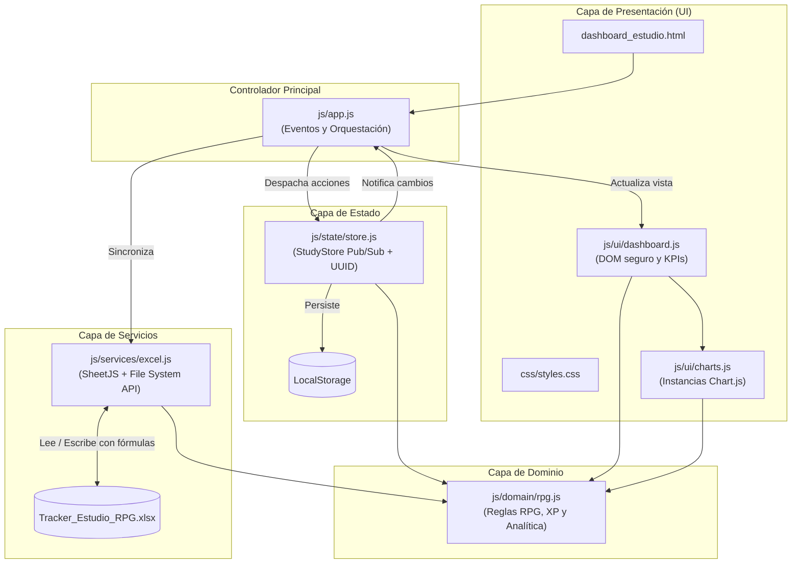

# ⚔️ StudyTracker RPG — Dashboard Local de Estudio

Aplicación web **Local-First** gamificada (estilo RPG) para registrar bloques de estudio, medir la calidad de concentración, evaluar la autonomía frente al uso de IA y sincronizar los datos con hojas de cálculo de Excel (`.xlsx`) que incluyen fórmulas reales autocalculables.

---

## ✨ Características Principales

- **Gamificación RPG:** Cálculo automático de puntos de experiencia (`XP`), subida de nivel cada `500 XP` y evolución de rangos (*Novato del Enfoque* → *Señor del Flujo Profundo*).
- **Analítica Biológica y Académica:**
  - Gráfico combinado (Barras + Línea) para identificar tus **horas pico de concentración** a lo largo del día.
  - Gráfico comparativo por materia entre **tiempo invertido** y **porcentaje de dependencia de IA**.
- **Sincronización con Excel (`.xlsx`):**
  - Exportación de libros `.xlsx` con **fórmulas nativas de Excel** inyectadas en cada fila (`TIMEVALUE`, `MOD`, `ROUND`, `SUM`, `AVERAGE`) y una segunda pestaña de resumen y guía.
  - Importación desde archivos `.xlsx`, `.xls` o `.csv`.
  - **Vinculación en vivo** mediante *File System Access API* (en navegadores Chromium sobre contexto seguro) para sobreescribir automáticamente el archivo local al agregar o eliminar sesiones.
- **Privacidad y Cero Dependencias de Servidor:** Funciona 100% en el navegador usando `localStorage` como persistencia inmediata.

---

## 🏗️ Arquitectura del Proyecto

El proyecto sigue una **arquitectura modular en capas** con un contenedor de estado centralizado (**Patrón Store / Pub-Sub**), diseñada para funcionar tanto abriendo el archivo directamente (`file://`) como desde un servidor local (`http://localhost`).



### 📂 Estructura de Directorios

```text
tracker_estudio/
├── dashboard_estudio.html       # Punto de entrada HTML semántico
├── Tracker_Estudio_RPG.xlsx     # Archivo Excel local con historial y fórmulas
├── README.md                    # Documentación del proyecto y arquitectura
├── css/
│   └── styles.css               # Variables de tema, layout responsive y componentes
└── js/
    ├── domain/
    │   └── rpg.js               # Reglas de negocio puras (minutos, XP, niveles, KPIs)
    ├── state/
    │   └── store.js             # Store reactivo (Pub/Sub), validación e IDs únicos
    ├── services/
    │   └── excel.js             # Construcción de .xlsx con fórmulas y File System API
    ├── ui/
    │   ├── charts.js            # Gestión y actualización eficiente de Chart.js
    │   └── dashboard.js         # Renderizado seguro del DOM (prevención XSS) y formulario
    └── app.js                   # Inicializador y enlace de eventos DOM
```

### decisiones Clave de Diseño

1. **Separación de Responsabilidades (SoC):** La lógica matemática de tiempos, cálculo de XP y agregaciones por hora/materia reside exclusivamente en `js/domain/rpg.js`, sin acoplamiento con el DOM.
2. **Identificadores Únicos (`UUID`):** Cada sesión recibe un `id` único en `js/state/store.js` (`crypto.randomUUID()`), permitiendo eliminar o filtrar sesiones sin depender del índice del arreglo.
3. **Renderizado Seguro (Prevención XSS):** En `js/ui/dashboard.js` todas las celdas de la tabla se construyen con `document.createElement` y `textContent`, evitando inyecciones de HTML al importar archivos Excel externos.
4. **Reutilización de Lienzos en Chart.js:** `js/ui/charts.js` actualiza los arreglos `data` y ejecuta `chart.update()` en lugar de destruir y recrear el `<canvas>` en cada cambio.

---

## 🧮 Fórmulas del Sistema RPG y Excel

| Métrica | Regla / Fórmula en la App | Fórmula Inyectada en Excel (`.xlsx`) |
| :--- | :--- | :--- |
| **Duración (min)** | Diferencia entre `Hora_Fin` y `Hora_Inicio` (soporta cruce de medianoche sumando `1440` min). | `=IF(OR(B2="",C2=""),"",MOD(TIMEVALUE(C2)-TIMEVALUE(B2),1)*1440)` |
| **XP Ganados** | $\text{REDONDEAR}(\text{Duración} \times (1 + \text{Calidad} \times 0.2))$ | `=IF(E2="","",ROUND(E2*(1+(F2*0.2)),0))` |
| **Nivel Actual** | Cada **500 XP** acumulados subes 1 nivel. | `=INT(SUM(Registro_Estudio!H2:H1000)/500)+1` |

---

## 🚀 Cómo Usar el Proyecto

### Opción 1: Apertura Directa (Sin instalación)
1. Abre directamente el archivo `dashboard_estudio.html` con doble clic en cualquier navegador moderno.
2. Registra tus sesiones en el formulario izquierdo; los datos se guardan automáticamente en la memoria del navegador (`localStorage`).
3. Usa **📂 Importar .xlsx** para cargar tu archivo `Tracker_Estudio_RPG.xlsx` y **📥 Guardar / Descargar Excel (.xlsx)** para exportar tus sesiones actualizadas.

### Opción 2: Servidor Local (Para sincronización en vivo con Excel)
La API de acceso directo a archivos locales (*File System Access API*) requiere un contexto seguro (`localhost` o `https`) en navegadores basados en Chromium (Chrome, Edge, Brave).

Puedes levantar un servidor local en esta carpeta con cualquiera de estos comandos:

```powershell
# Con Python
python -m http.server 8080

# O con Node.js (npx)
npx serve .
```

Luego abre `http://localhost:8080/dashboard_estudio.html` y haz clic en **🔗 Vincular Excel (.xlsx)** para que cada cambio en el dashboard se guarde directamente sobre `Tracker_Estudio_RPG.xlsx`.

