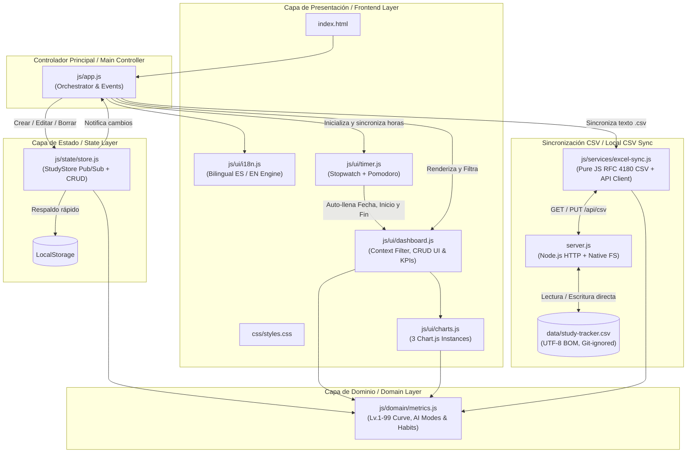

# ⚔️ StudyTracker — Local-First Analytics & CSV Sync

> 🌐 **Idioma / Language:** [🇪🇸 Español](#-español) | [🇬🇧 English](#-english)

---

## 🇪🇸 Español

Aplicación web **Local-First** gamificada (estilo RPG) ultra-ligera con **micro-servidor local en Node.js** (y soporte directo por navegador vía *File System Access API*) para registrar, editar y eliminar bloques de estudio, evaluar hábitos cognitivos y sincronizar los datos en tiempo real directamente sobre un archivo CSV local (`data/study-tracker.csv`) sin librerías de hojas de cálculo externas.

### ✨ Características Principales

- **Curva Exponencial de Nivel RPG (*"Level 92 is half of 99"*):**
  - Inspirada en *Old School RuneScape*, la experiencia requerida **se duplica cada 7 niveles**:
    $$\text{XP}(\text{Nivel } L) = \text{REDONDEAR}\Big( 250 \times \left(2^{(L-1)/7} - 1\right) \Big)$$
  - Subida rápida en los primeros niveles para motivar la constancia, progresión creciente (+10.4% por nivel) y propiedad matemática exacta donde el **Nivel 92 representa el 50% del XP total hacia el Nivel 99**.
- **Taxonomía Ortogonal de 1 Clic (`4 Contextos` × `8 Actividades`):**
  - **Contexto / Propósito (4 chips):**
    - `🎓 Académico`: Materias universitarias/escolares, tareas y exámenes de carrera.
    - `🏅 Certificación`: Certificaciones profesionales (ej. *Snowflake*) y cursos técnicos estructurados.
    - `🚀 Proyecto Propio`: Desarrollo de software personal, portafolio o proyectos en pareja.
    - `🤝 Externo`: Proyectos de amigos/terceros (ej. *Ruby on Rails*), incluyendo el estudio requerido para ellos.
  - **Tipo de Actividad (8 chips con ayuda dinámica en vivo):**

| Actividad | ¿Qué significa y cuándo usarla? | ¿Cómo no confundirla con otras? |
| :--- | :--- | :--- |
| **`🗂️ Preparación / Contexto`** | **Antes de estudiar o programar:** armar el entorno, instalar paquetes, recopilar PDFs/links o *"masticar"* información en un LLM para dejar listo el contexto de un proyecto multi-sesión. | No estás leyendo teoría a fondo ni programando todavía; estás **preparando la mesa y las fuentes** para ahorrar tiempo en futuras sesiones. |
| **`👨‍🏫 Clase / Cátedra`** | **En vivo con un profesor o ponente:** asistir a una clase escolar, cátedra universitaria o taller guiado. Evalúa tu **concentración, interés y retención**. | Aquí el ritmo lo lleva un **profesor en vivo**. Si estudias un curso pregrabado o lees por tu cuenta a tu ritmo, usa `📖 Teoría / Docs`. |
| **`📖 Teoría / Docs`** | **Consumo estructurado a tu propio ritmo:** leer documentación oficial (ej. *Snowflake Docs*), libros, artículos técnicos o ver videocursos grabados. | Sigue una **fuente lineal o guía oficial**. Si en cambio estás saltando entre fuentes para responder una duda abierta o debatiendo un *"¿por qué?"*, es `💬 Investigación / Diálogo`. |
| **`💬 Investigación / Diálogo`** | **Explorar dudas abiertas o debatir conceptos:** buscar cómo/por qué funciona algo, comparar tecnologías o tener una sesión socrática de preguntas y respuestas con IA. | No sigues un manual de principio a fin (`📖 Teoría / Docs`); estás **investigando una incógnita puntual o dialogando** para destrabar tu comprensión. |
| **`✍️ Diseño / Apuntes`** | **Sintetizar y estructurar con tus palabras:** pasar en limpio apuntes (en cuaderno o compu), hacer resúmenes propios, mapas mentales o diagramas (ER, arquitectura). | Mientras que en `📖 Teoría` consumes información, aquí **produces síntesis o diseño** sin escribir código todavía. |
| **`💻 Desarrollo / Código`** | **Construir e implementar:** escribir código nuevo, consultas SQL, scripts o desarrollar funcionalidades de un proyecto o entregable. | Es **creación de software/entregables**. Si el código ya existe y estás cazando un error o resolviendo ejercicios aislados, usa `🧪 Práctica / Debugging`. |
| **`🧪 Práctica / Debugging`** | **Ejercitar o destrabar errores:** hacer laboratorios prácticos, ejercicios tipo kata/algoritmos o depurar (*debugging*) un bug hasta encontrar la causa. | Se enfoca en **entrenar destreza o arreglar fallos**, no en levantar funcionalidades nuevas desde cero (`💻 Desarrollo`). |
| **`🔁 Repaso / Simulacro`** | **Consolidar memoria sobre algo ya visto:** repasar tus propios apuntes previos, flashcards, explicar un tema sin mirar o hacer exámenes de simulacro (*mock exams*). | Solo aplica a temas que **ya estudiaste antes** y estás reforzando para no olvidarlos o para medirte antes de un examen. |

- **¿Qué pasa si estoy en `👨‍🏫 Clase / Cátedra` y uso IA?**
  - Al seleccionar `👨‍🏫 Clase / Cátedra`, el formulario ajusta por defecto **`🧠 Autónomo (0% IA)`** para ahorrarte clics cuando solo escuchas al profesor, pero **puedes cambiar libremente el Modo de IA** según lo que haya pasado en el salón:
    1. **Sin IA (`🧠 Autónomo · 0%` → `+5% XP`):** Atendiste la clase y tomaste notas por tu cuenta. La escala 1–5 mide tu concentración e interés.
    2. **Usar IA para resolver dudas que surgen en clase (`💬 Diálogo / Tutoría` o `🛠️ Copiloto` → `+5%` / `0% XP`):** El profesor explicó algo confuso y le preguntaste a la IA un ejemplo rápido para no perder el hilo. La IA **apoyó tu comprensión en vivo** y la ayuda del formulario te guía a calificar qué tanto retuviste gracias a ese apoyo.
    3. **Usar IA en clase solo para acabar rápido una actividad (`🤖 Mecánico / Copy-Paste` → `-15% XP`):** El profesor dejó un ejercicio en clase y usaste pura asistencia de IA para entregarlo rápido sin procesarlo. El sistema **te descuenta `-15% XP`**, registra esos minutos como **Mecánicos** en las gráficas del Dashboard y te advierte en la escala de Asimilación considerar nivel `1` o `2`.
- **Impacto Cognitivo de IA y Calidad de Asimilación (1 al 5):**
  - Separa la **fluidez mecánica** del **aprendizaje real**: la escala 1–5 evalúa tu **Asimilación Cognitiva** (desde `1 - Mecánico / Sin retención` hasta `5 - Asimilación profunda`).
  - **Modo de Uso de IA (4 chips):**
    - `🧠 Autónomo (+5% XP)`: 100% por tu cuenta (0% IA).
    - `💬 Diálogo / Tutoría (+5% XP)`: Debate conceptual, preguntas de *"¿por qué?"* y refuerzo activo con IA.
    - `🛠️ Copiloto / Apoyo (0% ajuste)`: Consulta puntual de sintaxis o desbloqueo de bugs entendiendo la solución.
    - `🤖 Mecánico / Copy-Paste (-15% XP)`: Automatización directa para entregar rápido sin leer a fondo.
  - El Dashboard contrasta en vivo tus minutos de **Aprendizaje (Autónomo / Diálogo / Copiloto)** frente a los minutos **Mecánicos (Copy-Paste)** por materia.
- **Filtro Rápido por Contexto e Historial Compacto:**
  - Barra de pestañas interactiva (`🌐 Todos`, `🎓 Académico`, `🏅 Certificación`, `🚀 Proyecto Propio`, `🤝 Externo`) que filtra al instante las tarjetas KPI, los 3 gráficos y la tabla de historial manteniendo tu nivel global de personaje en la barra superior.
  - **Vista compacta de últimos 5 registros:** La tabla muestra por defecto solo las **5 sesiones más recientes** para evitar que el Dashboard crezca sin límite, con un botón **`📂 Ver todos (X)` / `⬆️ Mostrar solo últimos 5`** para expandir o contraer en 1 clic sin afectar los cálculos globales.
- **Detector de Bloqueos y Avance del Bloque (sin castigar tareas largas):**
  - **Complejidad:** `🟢 Fácil (+0% XP)` · `🟡 Desafiante (+10% XP)` · `🔴 Muy difícil (+20% XP)`.
  - **¿Avance del Bloque / Meta? (con guía dinámica en vivo):**
    - `✅ Sí (Buen avance +10% XP)`: Completaste la meta planeada **o** avanzaste a muy buen ritmo en una tarea larga que continuará en otra sesión (así los proyectos largos no te penalizan el XP).
    - `⚠️ Parcial (Con tropiezos +5% XP)`: Hubo progreso, pero fue menor o más lento de lo esperado por dudas o distracciones parciales.
    - `❌ No (Bloqueo / 0% XP)`: Bloqueo técnico, distracción total o interrupción sin lograr avance (contabilizado en el indicador de bloqueos).
- **Cronómetro y Temporizador Pomodoro Integrado:**
  - **Modo Cronómetro (`⏱️`):** Cuenta progresiva con captura automática de la **Fecha**, **Hora de Inicio** al pulsar *Iniciar* y **Hora de Fin** al pulsar *Terminar* (o al guardar directamente la sesión).
  - **Modo Pomodoro (`🍅`):** Cuenta regresiva por bloques de enfoque (`25m`, `50m` o personalizado) y bloques de descanso (`5m`, `15m`) con aviso acústico vía *Web Audio API*.
  - Basado en marcas de tiempo reales (`Date.now()`) y persistencia en `localStorage` para no perder precisión en segundo plano ni al recargar la pestaña.
- **Sincronización en Tiempo Real con CSV (`data/study-tracker.csv`) y Cero Dependencias de Excel:**
  - Todas las fórmulas (duración con cruce de medianoche, XP, bonos y curva de niveles) viven en **JavaScript puro** (`js/domain/metrics.js`), eliminando la librería `SheetJS` (~850 KB) y la duplicación de fórmulas.
  - **Modo 1 (Servidor Local `server.js`):** Cada alta, edición (`✏️`) o eliminación (`✖`) actualiza directamente `data/study-tracker.csv` (con firma `UTF-8 BOM` compatible con acentos y emojis) sin preguntar nada.
  - **Modo 2 (100% Navegador sin servidor):** Si abres la app sin `server.js` y pulsas *Sincronizar CSV*, puedes vincular un archivo `.csv` local usando la *File System Access API* del navegador.
  - La carpeta `data/` y los archivos `.csv` están excluidos en `.gitignore` por privacidad.
- **Interfaz Bilingüe en Tiempo Real (`ES` / `EN`):**
  - Selector rápido `ES` | `EN` en la barra superior con persistencia en `localStorage` (`study_tracker_lang`).
  - Traduce al instante toda la interfaz, el cronómetro/Pomodoro, las ayudas dinámicas, los gráficos de Chart.js y la tabla de historial, manteniendo intactos los valores canónicos en el `Store` y en `data/study-tracker.csv`.

### 🏗️ Arquitectura del Proyecto

### 🧮 Esquema de 18 Columnas en CSV (`data/study-tracker.csv`) y Fórmulas en JavaScript

El archivo `data/study-tracker.csv` se guarda en texto plano `UTF-8 con BOM` (estándar RFC 4180, listo para Python, Pandas, Snowflake, SQLite o Excel) con las siguientes 18 columnas:

`Fecha,Dia_Semana,Hora_Inicio,Hora_Fin,Franja_Horaria,Contexto,Materia,Tema,Tipo_Actividad,Energia_Previa,Complejidad,Objetivo_Cumplido,Duracion_Minutos,Calidad,Modo_IA,Uso_IA_Porcentaje,XP_Ganados,Notas`

| Métrica | Regla / Fórmula en JavaScript (`js/domain/metrics.js`) |
| :--- | :--- |
| **Duración (min)** | Diferencia entre `Hora_Fin` y `Hora_Inicio` (soporta cruce de medianoche sumando `1440` min). |
| **XP Ganados** | $\text{REDONDEAR}\Big(\text{Duración} \times \max(0.5,\ 1 + \text{Calidad}\times 0.2 + \text{BonoReto} + \text{BonoMeta} + \text{BonoModoIA})\Big)$ |
| **Nivel Exponencial (1-99)** | $\text{XP}(L) = \text{REDONDEAR}\big(250 \times (2^{(L-1)/7} - 1)\big)$ *(Nivel 92 = 50% de 99)* |
| **Tasa Objetivos (Sí)** | Porcentaje de sesiones donde `Objetivo_Cumplido === "Sí"`. |
| **Bloqueos (No)** | Total de sesiones con bloqueo o sin avance (`Objetivo_Cumplido === "No"`). |

### 🚀 Cómo Iniciar el Proyecto

No requiere instalar paquetes externos (`node_modules`), ya que tanto el frontend como `server.js` usan código nativo:

1. Haz doble clic en **`start.bat`** (o ejecuta `npm start` / `node server.js` en la terminal).
2. Se abrirá automáticamente `http://localhost:3000`.
3. El indicador superior mostrará **`🟢 Sincronizado en vivo: data/study-tracker.csv`**.
4. Cada sesión que registres, edites (`✏️`) o elimines (`✖`) actualizará instantáneamente el archivo `data/study-tracker.csv`.

---

## 🇬🇧 English

An ultra-lightweight gamified **Local-First** web application (RPG-style) powered by a **zero-dependency Node.js micro-server** (plus direct browser *File System Access API* support) to log, edit, and delete study blocks, evaluate cognitive habits, and sync your data in real time directly onto a local CSV file (`data/study-tracker.csv`) with zero external spreadsheet libraries.

### ✨ Key Features

- **Exponential RPG Level Curve (*"Level 92 is half of 99"*):**
  - Inspired by *Old School RuneScape*, required experience **doubles every 7 levels**:
    $$\text{XP}(\text{Level } L) = \text{ROUND}\Big( 250 \times \left(2^{(L-1)/7} - 1\right) \Big)$$
  - Fast early leveling to reward consistency, progressive scaling (+10.4% per level), and the exact mathematical property where **Level 92 equals 50% of the total XP required for Level 99**.
- **Orthogonal 1-Click Taxonomy (`4 Contexts` × `8 Activities`):**
  - **Context / Purpose (4 chips):**
    - `🎓 Academic` (`Académico`): University/school courses, assignments, and degree exams.
    - `🏅 Certification` (`Certificación`): Professional certifications (e.g., *Snowflake*) and structured technical courses.
    - `🚀 Own Project` (`Proyecto Propio`): Personal software engineering, portfolio, or duo projects.
    - `🤝 External` (`Externo`): Third-party or friends' projects (e.g., *Ruby on Rails*), including the research required for them.
  - **Activity Type (8 chips with live dynamic helper):**

| Activity | What it means & when to use it | How to distinguish it from similar ones |
| :--- | :--- | :--- |
| **`🗂️ Prep / Context`** (`Preparación / Contexto`) | **Before studying or coding:** setting up the environment, gathering sources, or *"digesting"* information in an LLM to prepare context for a multi-session project. | You aren't reading theory deeply or coding yet; you are **setting the stage and curating context** to save time in future sessions. |
| **`👨‍🏫 Class / Lecture`** (`Clase / Cátedra`) | **Live with a professor or speaker:** attending a school/university lecture or guided workshop. Measures your **focus, interest, and live retention**. | Paced by a **live instructor**. If you are studying a recorded course or reading on your own schedule, use `📖 Theory / Docs`. |
| **`📖 Theory / Docs`** (`Teoría / Docs`) | **Self-paced structured consumption:** reading official documentation (e.g., *Snowflake Docs*), books, articles, or watching recorded courses. | Follows a **linear source or official guide**. If you are jumping across sources to answer an open question or debating *"why?"*, use `💬 Research / Dialogue`. |
| **`💬 Research / Dialogue`** (`Investigación / Diálogo`) | **Exploring open questions or debating concepts:** investigating how/why something works, comparing tools, or having a Socratic Q&A session with AI. | Not following a manual from start to finish (`📖 Theory / Docs`); you are **investigating a specific question or dialoguing** to unlock understanding. |
| **`✍️ Design / Notes`** (`Diseño / Apuntes`) | **Synthesizing & structuring in your own words:** writing clean notes (notebook or PC), summaries, mind maps, or architecture/ER diagrams. | While `📖 Theory` is consuming information, here you **produce synthesis or design** without writing code yet. |
| **`💻 Dev / Code`** (`Desarrollo / Código`) | **Building & implementing:** writing new code, SQL queries, scripts, or developing project/assignment features. | Focused on **building deliverables/features**. If you are hunting down a bug or solving isolated practice problems, use `🧪 Practice / Debugging`. |
| **`🧪 Practice / Debugging`** (`Práctica / Debugging`) | **Practicing or unblocking errors:** hands-on labs, coding katas, or debugging an issue until finding and fixing the root cause. | Focused on **training skill or fixing bugs**, rather than building new features from scratch (`💻 Dev / Code`). |
| **`🔁 Review / Mock Exam`** (`Repaso / Simulacro`) | **Consolidating memory on previously studied material:** reviewing your own notes, flashcards, explaining from memory, or taking mock exams. | Only applies to topics you **already studied before** and are reinforcing for retention or exam readiness. |

- **What happens if I use AI during `👨‍🏫 Class / Lecture`?**
  - Clicking `👨‍🏫 Class / Lecture` defaults to **`🧠 Autonomous (0% AI)`** to save clicks when you just listen to the instructor, but **you can freely switch the AI Mode** depending on what happened during class:
    1. **No AI (`🧠 Autonomous · 0%` → `+5% XP`):** You paid attention and took your own notes. The 1–5 scale rates your focus and interest.
    2. **Using AI to clarify live questions (`💬 Dialogue / Tutoring` or `🛠️ Copilot` → `+5%` / `0% XP`):** The professor mentioned something unclear and you asked AI for a quick example to stay on track. AI **boosted your live comprehension**.
    3. **Using AI just to finish an in-class activity quickly (`🤖 Mechanical / Copy-Paste` → `-15% XP`):** You delegated an in-class exercise to AI just to turn it in fast without processing it. The app **applies the `-15% XP` penalty**, logs those minutes as **Mechanical** in the Dashboard charts, and warns you to consider assimilation level `1` or `2`.
- **Cognitive AI Impact & Learning Assimilation Scale (1 to 5):**
  - Separates **mechanical speed** from **real learning**: the 1–5 scale measures your **Cognitive Assimilation** (from `1 - Mechanical / No retention` up to `5 - Deep assimilation`).
  - **AI Interaction Mode (4 chips):**
    - `🧠 Autonomous (+5% XP)`: 100% on your own (0% AI).
    - `💬 Dialogue / Tutoring (+5% XP)`: Conceptual debate, *"why?"* questions, and active reinforcement with AI.
    - `🛠️ Copilot / Support (0% adj.)`: Targeted syntax lookup or bug unblocking while understanding the fix.
    - `🤖 Mechanical / Copy-Paste (-15% XP)`: Direct automation to deliver quickly without reading deeply.
  - The Dashboard contrasts your **Real Learning Minutes (Autonomous / Dialogue / Copilot)** against **Mechanical Minutes (Copy-Paste)** per subject.
- **Quick Context Filter Bar & Compact History:**
  - Interactive tab bar (`🌐 All`, `🎓 Academic`, `🏅 Certification`, `🚀 Own Project`, `🤝 External`) that instantaneously filters KPI cards, all 3 charts, and the history table while keeping your global character level in the top banner.
  - **Latest 5 records compact view:** The history table displays only the **5 most recent sessions** by default so the page stays clean as your database grows, with a 1-click **`📂 View all (X)` / `⬆️ Show latest 5 only`** toggle button.
- **Blocker Detector & Block Progress (no penalty on long tasks):**
  - **Complexity:** `🟢 Easy (+0% XP)` · `🟡 Challenging (+10% XP)` · `🔴 Very Hard (+20% XP)`.
  - **Block Progress / Goal? (with live helper guide):**
    - `✅ Yes (Solid progress +10% XP)`: Completed the planned goal **or** made steady progress on a long multi-session task (so multi-session projects never penalize your XP).
    - `⚠️ Partial (With hurdles +5% XP)`: Moved forward, but slower than expected due to doubts or partial distractions.
    - `❌ No (Blocked / 0% XP)`: Technical blocker, total distraction, or interruption without progress (counted in the blockers metric).
- **Built-in Stopwatch & Pomodoro Timer:**
  - **Stopwatch Mode (`⏱️`):** Count-up timer that automatically captures the **Date**, **Start Time** when clicking *Start*, and **End Time** when clicking *Finish* (or when submitting the form directly).
  - **Pomodoro Mode (`🍅`):** Countdown timer with focus presets (`25m`, `50m`, or custom minutes) and break presets (`5m`, `15m`) with an acoustic chime via *Web Audio API*.
  - Driven by real wall-clock timestamps (`Date.now()`) and `localStorage` persistence so it never drifts in background tabs or across page reloads.
- **Real-Time CSV Synchronization (`data/study-tracker.csv`) & Zero Spreadsheet Libraries:**
  - All formulas (duration with midnight crossover, XP, bonuses, and level curve) live in **pure JavaScript** (`js/domain/metrics.js`), eliminating the external `SheetJS` library (~850 KB) and formula duplication.
  - **Mode 1 (Local Server `server.js`):** Every new entry, inline edit (`✏️`), or deletion (`✖`) directly updates `data/study-tracker.csv` (`UTF-8 with BOM`) on disk without prompts.
  - **Mode 2 (100% Browser without server):** If opened without `server.js`, clicking *Sync CSV* lets you link a local `.csv` file directly using the browser's *File System Access API*.
  - The `data/` folder and `.csv` files are excluded in `.gitignore` for privacy.
- **Real-Time Bilingual Interface (`ES` / `EN`):**
  - Quick `ES` | `EN` toggle in the top bar persisted in `localStorage` (`study_tracker_lang`).
  - Instantly translates the entire UI, stopwatch/Pomodoro, dynamic helper boxes, Chart.js labels, and history table while preserving canonical data values in the `Store` and `data/study-tracker.csv`.

### 🧮 18-Column CSV Schema (`data/study-tracker.csv`) & JavaScript Formulas

The generated `data/study-tracker.csv` file is stored in plain-text `UTF-8 with BOM` (RFC 4180 standard, ready for Python, Pandas, Snowflake, SQLite, or Excel) with the following 18 columns:

`Fecha,Dia_Semana,Hora_Inicio,Hora_Fin,Franja_Horaria,Contexto,Materia,Tema,Tipo_Actividad,Energia_Previa,Complejidad,Objetivo_Cumplido,Duracion_Minutos,Calidad,Modo_IA,Uso_IA_Porcentaje,XP_Ganados,Notas`

| Metric | Rule / Formula in JavaScript (`js/domain/metrics.js`) |
| :--- | :--- |
| **Duration (min)** | Difference between `Hora_Fin` and `Hora_Inicio` (supports midnight crossover by adding `1440` min). |
| **XP Earned** | $\text{ROUND}\Big(\text{Duration} \times \max(0.5,\ 1 + \text{Quality}\times 0.2 + \text{ChallengeBonus} + \text{GoalBonus} + \text{AiModeBonus})\Big)$ |
| **Exponential Level (1-99)** | $\text{XP}(L) = \text{ROUND}\big(250 \times (2^{(L-1)/7} - 1)\big)$ *(Level 92 = 50% of 99)* |
| **Goal Rate (Yes)** | Percentage of sessions where `Objetivo_Cumplido === "Sí"`. |
| **Blockers (No)** | Total sessions with a blocker or no progress (`Objetivo_Cumplido === "No"`). |

### 🚀 Getting Started

No external `node_modules` installation is required, as both the frontend and `server.js` use native code:

1. Double-click **`start.bat`** (or run `npm start` / `node server.js` in your terminal).
2. `http://localhost:3000` will open automatically in your browser.
3. The top status pill will display **`🟢 Live synced: data/study-tracker.csv`**.
4. Every session you log, edit (`✏️`), or delete (`✖`) will instantaneously update `data/study-tracker.csv`.
