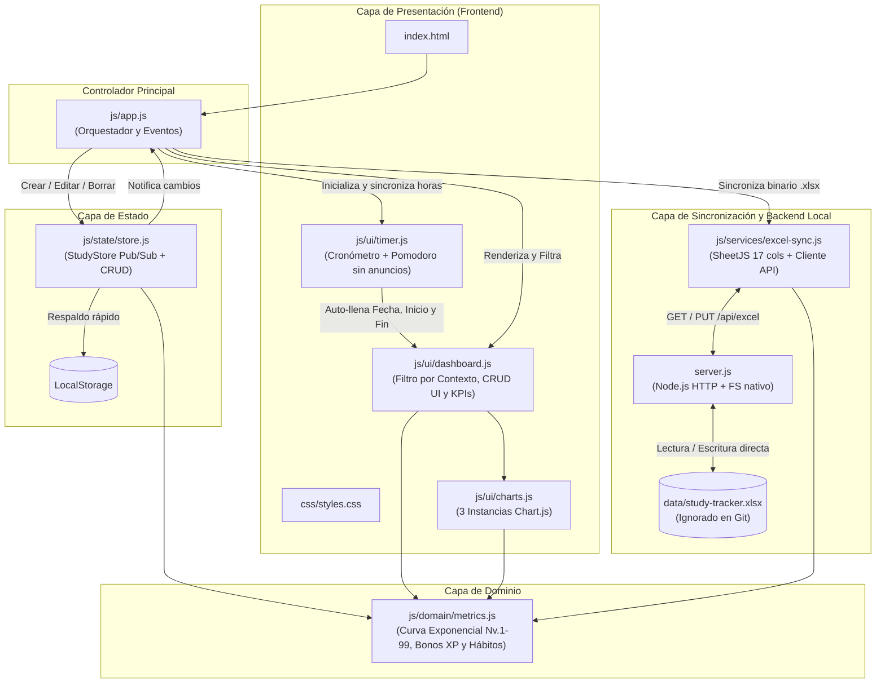

# ⚔️ StudyTracker — Local-First Analytics & Excel Sync

Aplicación web **Local-First** gamificada (estilo RPG) con **micro-servidor local en Node.js** para registrar, editar y eliminar bloques de estudio, evaluar hábitos cognitivos y sincronizar los datos en tiempo real directamente sobre un archivo Excel local (`data/study-tracker.xlsx`) con fórmulas nativas autocalculables.

---

## ✨ Características Principales

- **Curva Exponencial de Nivel RPG (*"Level 92 is half of 99"*):**
  - Inspirada en *Old School RuneScape*, la experiencia requerida **se duplica cada 7 niveles**:
    $$\text{XP}(\text{Nivel } L) = \text{REDONDEAR}\Big( 250 \times \left(2^{(L-1)/7} - 1\right) \Big)$$
  - Subida rápida en los primeros niveles para motivar la constancia, progresión creciente (+10.4% por nivel) y propiedad matemática exacta donde el **Nivel 92 representa el 50% del XP total hacia el Nivel 99**.
- **Taxonomía Ortogonal de 1 Clic (`Contexto` × `Actividad`):**
  - **Contexto / Propósito (4 chips):**
    - `🎓 Académico`: Materias universitarias/escolares, tareas y exámenes de carrera.
    - `🏅 Certificación`: Certificaciones profesionales (ej. *Snowflake*) y cursos técnicos estructurados.
    - `🚀 Proyecto Propio`: Desarrollo de software personal, portafolio o proyectos en pareja.
    - `🤝 Externo`: Proyectos de amigos/terceros (ej. *Ruby on Rails*), incluyendo el estudio requerido para ellos.
  - **Tipo de Actividad (4 chips universales):**
    - `💻 Código / Práctica` · `📖 Teoría / Docs` · `✍️ Papel / Diseño` · `🔁 Repaso / Test`.
- **Filtro Rápido por Contexto en el Dashboard:**
  - Barra de pestañas interactiva (`🌐 Todos`, `🎓 Académico`, `🏅 Certificación`, `🚀 Proyecto Propio`, `🤝 Externo`) que filtra al instante las tarjetas KPI, los 3 gráficos y la tabla de historial manteniendo tu nivel global de personaje en la barra superior.
- **Detector de Bloqueos y Bonos de Esfuerzo:**
  - **Complejidad:** `🟢 Fácil (+0% XP)` · `🟡 Desafiante (+10% XP)` · `🔴 Muy difícil (+20% XP)`.
  - **¿Objetivo Cumplido? (con guía dinámica en vivo):**
    - `✅ Sí (Logrado +10% XP)`: Completaste la meta planeada para el bloque.
    - `⚠️ Parcial (Avance +5% XP)`: Hubo avance real y aprendizaje, pero continuará en otra sesión.
    - `❌ No (Bloqueo / 0% XP)`: Bloqueo técnico, distracción total o interrupción sin lograr avance (contabilizado en el indicador de bloqueos).
- **Cronómetro y Temporizador Pomodoro Integrado (100% Libre de Anuncios):**
  - **Modo Cronómetro (`⏱️`):** Cuenta progresiva con captura automática de la **Fecha**, **Hora de Inicio** al pulsar *Iniciar* y **Hora de Fin** al pulsar *Terminar* (o al guardar directamente la sesión).
  - **Modo Pomodoro (`🍅`):** Cuenta regresiva por bloques de enfoque (`25m`, `50m` o personalizado) y bloques de descanso (`5m`, `15m`) con aviso acústico vía *Web Audio API* (sin anuncios ni dependencias externas).
  - Basado en marcas de tiempo reales (`Date.now()`) y persistencia en `localStorage` para no perder precisión en segundo plano ni al recargar la pestaña.
- **Sincronización en Tiempo Real con Excel (`data/study-tracker.xlsx`):**
  - Cada alta, edición en línea (`✏️`) o eliminación (`✖`) actualiza directamente `data/study-tracker.xlsx` en tu disco duro sin descargas repetidas.
  - La carpeta `data/` y los archivos `.xlsx` están excluidos en `.gitignore` por privacidad.

---

## 🏗️ Arquitectura del Proyecto

---

## 🧮 Estructura de 17 Columnas y Fórmulas en Excel (`data/study-tracker.xlsx`)

El archivo Excel generado contiene dos hojas (`Registro_Estudio` y `Guia_y_Resumen`) con las siguientes columnas:

`A: Fecha` · `B: Dia_Semana` · `C: Hora_Inicio` · `D: Hora_Fin` · `E: Franja_Horaria` · `F: Contexto` · `G: Materia` · `H: Tema` · `I: Tipo_Actividad` · `J: Energia_Previa` · `K: Complejidad` · `L: Objetivo_Cumplido` · `M: Duracion_Minutos` · `N: Calidad` · `O: Uso_IA_Porcentaje` · `P: XP_Ganados` · `Q: Notas`

| Métrica | Regla / Fórmula en la App | Fórmula Inyectada en Excel (`.xlsx`) |
| :--- | :--- | :--- |
| **Duración (min)** | Diferencia entre `Hora_Fin` y `Hora_Inicio` (soporta cruce de medianoche sumando `1440` min). | `=IF(OR(C2="",D2=""),"",MOD(TIMEVALUE(D2)-TIMEVALUE(C2),1)*1440)` |
| **XP Ganados** | $\text{REDONDEAR}\Big(\text{Duración} \times (1 + \text{Calidad}\times 0.2 + \text{BonoReto} + \text{BonoMeta})\Big)$ | `=IF(M2="","",ROUND(M2*(1+(N2*0.2)+IF(K2="Muy difícil",0.2,IF(K2="Desafiante",0.1,0))+IF(L2="Sí",0.1,IF(L2="Parcial",0.05,0))),0))` |
| **Nivel Exponencial (1-99)** | $\text{XP}(L) = \text{REDONDEAR}\big(250 \times (2^{(L-1)/7} - 1)\big)$ *(Nivel 92 = 50% de 99)* | `=MIN(99,INT(1+7*(LN(1+SUM(Registro_Estudio!P2:P1000)/250)/LN(2))))` |
| **Tasa Objetivos (Sí)** | Porcentaje de sesiones donde `Objetivo_Cumplido = "Sí"`. | `=IFERROR(COUNTIF(Registro_Estudio!L2:L1000,"Sí")/COUNTA(Registro_Estudio!G2:G1000),0)` |
| **Bloqueos (No)** | Total de sesiones con bloqueo o sin avance (`Objetivo_Cumplido = "No"`). | `=COUNTIF(Registro_Estudio!L2:L1000,"No")` |

---

## 🚀 Cómo Iniciar el Proyecto

### Opción Recomendada: Con Sincronización Automática en Excel
No requiere instalar paquetes externos (`node_modules`), ya que `server.js` utiliza únicamente módulos nativos de Node.js:

1. Haz doble clic en **`start.bat`** (o ejecuta `npm start` / `node server.js` en la terminal).
2. Se abrirá automáticamente `http://localhost:3000`.
3. El indicador superior mostrará **`🟢 Sincronizado en vivo: data/study-tracker.xlsx`**.
4. Cada sesión que registres, edites (`✏️`) o elimines (`✖`) actualizará instantáneamente el archivo `data/study-tracker.xlsx`.
