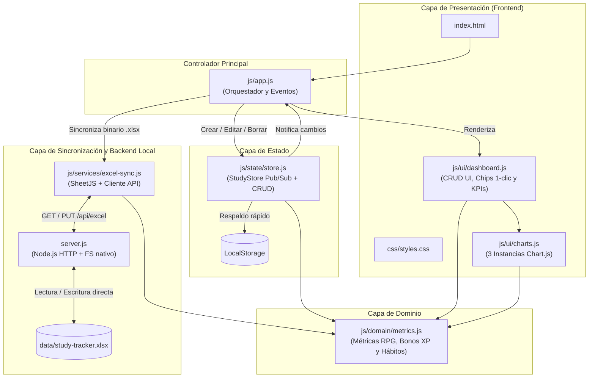

# ⚔️ StudyTracker — Local-First Analytics & Excel Sync

Aplicación web **Local-First** gamificada (estilo RPG) con **micro-servidor local en Node.js** para registrar, editar y eliminar bloques de estudio, evaluar hábitos cognitivos y sincronizar los datos en tiempo real directamente sobre un archivo Excel local (`data/study-tracker.xlsx`) con fórmulas nativas autocalculables.

---

## ✨ Características Principales

- **Sincronización en Tiempo Real con Excel (`data/study-tracker.xlsx`):**
  - **Cero descargas repetidas:** Cada vez que agregas, editas (`✏️`) o eliminas (`✖`) una sesión en el navegador, el servidor local actualiza directamente `data/study-tracker.xlsx` en tu disco duro.
  - **Detección de bloqueo de Windows:** Si tienes `data/study-tracker.xlsx` abierto en Microsoft Excel al mismo tiempo, el dashboard te avisa en pantalla y te permite sincronizar en cuanto lo cierres.
  - **Sincronización bidireccional:** Si editas filas directamente dentro de Microsoft Excel y guardas el archivo, el botón **📂 Recargar de Excel** importa tus cambios de vuelta al dashboard con un clic.
- **CRUD Completo de Sesiones:**
  - Creación con vista previa de XP y bonos en vivo.
  - **Edición en línea (`✏️`):** Haz clic en el icono de lápiz de cualquier fila del historial para cargarla en el formulario, corregir cualquier dato y actualizar el Excel automáticamente.
  - Eliminación individual por ID único (`UUID`) o reinicio completo.
- **Captura de Hábitos de Baja Fricción (1 Clic + Campos Automáticos):**
  - **Selectores rápidos (Chips):** *Tipo de Actividad* (`💻 Código`, `📖 Lectura`, `✍️ Papel / A mano`, `📝 Tarea / Entrega`, `🔁 Repaso`), *Energía Previa* (`🔋 Alta`, `⚡ Media`, `🪫 Baja`), *Complejidad* (`🟢 Fácil`, `🟡 Desafiante`, `🔴 Muy difícil`) y *Objetivo Cumplido* (`✅ Sí`, `⚠️ Parcial`, `❌ No`).
  - **Enriquecimiento automático (0 fricción):** Cálculo transparente de `Dia_Semana` y `Franja_Horaria` (*Madrugada*, *Mañana*, *Tarde*, *Noche*).

---

## 🏗️ Arquitectura del Proyecto



### 📂 Estructura de Directorios

```text
study-tracker/
├── index.html                   # Punto de entrada principal de la aplicación
├── server.js                    # Micro-servidor local Node.js (cero dependencias externas)
├── package.json                 # Configuración del proyecto y script npm start
├── start.bat                    # Lanzador de 1 clic para Windows
├── README.md                    # Documentación técnica y de arquitectura
├── data/
│   └── study-tracker.xlsx       # Base de datos Excel local sincronizada en vivo
├── css/
│   └── styles.css               # Estilos, variables de diseño y modo edición
└── js/
    ├── domain/
    │   └── metrics.js           # Reglas de negocio puras (minutos, XP, bonos, franjas y hábitos)
    ├── state/
    │   └── store.js             # Store reactivo (Pub/Sub) con soporte CRUD por ID único
    ├── services/
    │   └── excel-sync.js        # Construcción de .xlsx (15 columnas + fórmulas) y cliente API
    ├── ui/
    │   ├── charts.js            # Gestión y actualización eficiente de los 3 gráficos Chart.js
    │   └── dashboard.js         # Renderizado seguro del DOM, edición de filas y chips
    └── app.js                   # Inicializador y enlace de eventos DOM
```

---

## 🚀 Cómo Iniciar el Proyecto

### Opción Recomendada: Con Sincronización Automática en Excel
No requiere instalar paquetes externos (`node_modules`), ya que `server.js` utiliza únicamente módulos nativos de Node.js:

1. Haz doble clic en **`start.bat`** (o ejecuta `npm start` / `node server.js` en la terminal).
2. Se abrirá automáticamente `http://localhost:3000`.
3. El indicador superior mostrará **`🟢 Sincronizado en vivo: data/study-tracker.xlsx`**.
4. Cada sesión que registres, edites (`✏️`) o elimines (`✖`) actualizará instantáneamente el archivo `data/study-tracker.xlsx`.

### Opción Alternativa: Modo Solo Navegador (`index.html`)
También puedes abrir `index.html` directamente sin servidor; funcionará con la memoria del navegador (`localStorage`) y podrás usar los botones **📤 Importar otro .xlsx** y **📥 Descargar copia (.xlsx)** manualmente.
