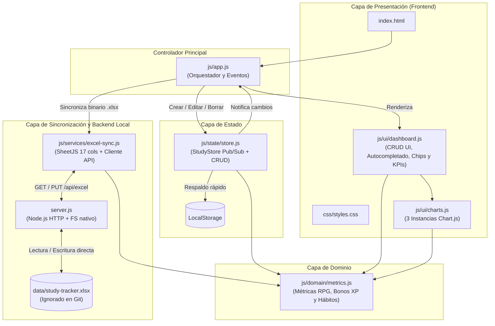

# ⚔️ StudyTracker — Local-First Analytics & Excel Sync

Aplicación web **Local-First** gamificada (estilo RPG) con **micro-servidor local en Node.js** para registrar, editar y eliminar bloques de estudio, evaluar hábitos cognitivos y sincronizar los datos en tiempo real directamente sobre un archivo Excel local (`data/study-tracker.xlsx`) con fórmulas nativas autocalculables.

---

## ✨ Características Principales

- **Sincronización en Tiempo Real con Excel (`data/study-tracker.xlsx`):**
  - **Cero descargas repetidas:** Cada vez que agregas, editas (`✏️`) o eliminas (`✖`) una sesión en el navegador, el servidor local actualiza directamente `data/study-tracker.xlsx` en tu disco duro.
  - **Privacidad de datos:** La carpeta `data/` y los archivos `.xlsx` están excluidos en `.gitignore` para no subir tus registros personales al repositorio público; si la carpeta no existe al clonar el proyecto, `server.js` la crea automáticamente.
  - **Detección de bloqueo de Windows:** Si tienes `data/study-tracker.xlsx` abierto en Microsoft Excel al mismo tiempo, el dashboard te avisa en pantalla y te permite sincronizar en cuanto lo cierres.
  - **Sincronización bidireccional:** Si editas filas directamente dentro de Microsoft Excel y guardas el archivo, el botón **📂 Recargar de Excel** importa tus cambios de vuelta al dashboard con un clic.
- **Modelado Jerárquico y Autocompletado Inteligente:**
  - Separación entre **Materia / Proyecto** (nivel macro para gráficas) y **Tema específico** (subtema o módulo).
  - Ambos campos alimentan automáticamente sus listas de sugerencias (`<datalist>`) con base en tu propio historial.
- **Captura de Hábitos de Baja Fricción (1 Clic + Campos Automáticos):**
  - **Contexto / Propósito:** `🎓 Escuela`, `🚀 Personal` (proyectos propios o en pareja) y `🤝 Externo` (encargos o apoyo a terceros).
  - **Tipo de Actividad:** `💻 Código / Práctica`, `📖 Lectura / Teoría`, `✍️ Papel / A mano` y `🔁 Repaso`.
  - **Estado y Esfuerzo:** *Energía Previa* (`🔋 Alta`, `⚡ Media`, `🪫 Baja`), *Complejidad* (`🟢 Fácil`, `🟡 Desafiante`, `🔴 Muy difícil`) y *Objetivo Cumplido* (`✅ Sí`, `⚠️ Parcial`, `❌ No`).
  - **Enriquecimiento automático (0 fricción):** Cálculo transparente de `Dia_Semana` y `Franja_Horaria` (*Madrugada*, *Mañana*, *Tarde*, *Noche*).

---

## 🏗️ Arquitectura del Proyecto



### 📂 Estructura de Directorios

```text
study-tracker/
├── index.html                   # Punto de entrada principal de la aplicación
├── server.js                    # Micro-servidor local Node.js (cero dependencias externas)
├── package.json                 # Configuración del proyecto y script npm start
├── start.bat                    # Lanzador de 1 clic para Windows
├── .gitignore                   # Excluye data/, archivos .xlsx y temporales de Excel
├── README.md                    # Documentación técnica y de arquitectura
├── data/                        # Generada automáticamente (ignorada en Git)
│   └── study-tracker.xlsx       # Base de datos Excel local sincronizada en vivo (17 columnas)
├── css/
│   └── styles.css               # Estilos, variables de diseño y modo edición
└── js/
    ├── domain/
    │   └── metrics.js           # Reglas de negocio puras (minutos, XP, bonos, contextos y hábitos)
    ├── state/
    │   └── store.js             # Store reactivo (Pub/Sub) con soporte CRUD por ID único
    ├── services/
    │   └── excel-sync.js        # Construcción de .xlsx (17 columnas + fórmulas) y cliente API
    ├── ui/
    │   ├── charts.js            # Gestión y actualización eficiente de los 3 gráficos Chart.js
    │   └── dashboard.js         # Renderizado seguro del DOM, autocompletado, edición y chips
    └── app.js                   # Inicializador y enlace de eventos DOM
```

---

## 🧮 Estructura de 17 Columnas y Fórmulas en Excel (`data/study-tracker.xlsx`)

El archivo Excel generado contiene dos hojas (`Registro_Estudio` y `Guia_y_Resumen`) con las siguientes columnas:

`A: Fecha` · `B: Dia_Semana` · `C: Hora_Inicio` · `D: Hora_Fin` · `E: Franja_Horaria` · `F: Contexto` · `G: Materia` · `H: Tema` · `I: Tipo_Actividad` · `J: Energia_Previa` · `K: Complejidad` · `L: Objetivo_Cumplido` · `M: Duracion_Minutos` · `N: Calidad` · `O: Uso_IA_Porcentaje` · `P: XP_Ganados` · `Q: Notas`

| Métrica | Regla / Fórmula en la App | Fórmula Inyectada en Excel (`.xlsx`) |
| :--- | :--- | :--- |
| **Duración (min)** | Diferencia entre `Hora_Fin` y `Hora_Inicio` (soporta cruce de medianoche sumando `1440` min). | `=IF(OR(C2="",D2=""),"",MOD(TIMEVALUE(D2)-TIMEVALUE(C2),1)*1440)` |
| **XP Ganados** | $\text{REDONDEAR}\Big(\text{Duración} \times (1 + \text{Calidad}\times 0.2 + \text{BonoReto} + \text{BonoMeta})\Big)$ | `=IF(M2="","",ROUND(M2*(1+(N2*0.2)+IF(K2="Muy difícil",0.2,IF(K2="Desafiante",0.1,0))+IF(L2="Sí",0.1,0)),0))` |
| **Nivel Actual** | Cada **500 XP** acumulados subes 1 nivel. | `=INT(SUM(Registro_Estudio!P2:P1000)/500)+1` |
| **Tasa Objetivos** | Porcentaje de sesiones donde `Objetivo_Cumplido = "Sí"`. | `=IFERROR(COUNTIF(Registro_Estudio!L2:L1000,"Sí")/COUNTA(Registro_Estudio!G2:G1000),0)` |

---

## 🚀 Cómo Iniciar el Proyecto

### Opción Recomendada: Con Sincronización Automática en Excel
No requiere instalar paquetes externos (`node_modules`), ya que `server.js` utiliza únicamente módulos nativos de Node.js:

1. Haz doble clic en **`start.bat`** (o ejecuta `npm start` / `node server.js` en la terminal).
2. Se abrirá automáticamente `http://localhost:3000`.
3. El indicador superior mostrará **`🟢 Sincronizado en vivo: data/study-tracker.xlsx`**.
4. Cada sesión que registres, edites (`✏️`) o elimines (`✖`) actualizará instantáneamente el archivo `data/study-tracker.xlsx`.

### Opción Alternativa: Modo Solo Navegador (`index.html`)
También puedes abrir `index.html` directamente sin servidor; funcionará con la memoria del navegador (`localStorage`) y podrás usar los botones **📤 Importar otro .xlsx** y **📥 Descargar copia (.xlsx)** manualmente.
