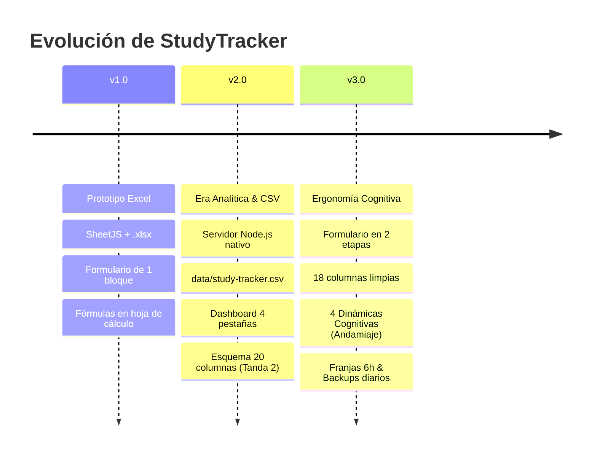

# 📐 Decisiones de Arquitectura e Historial de Versiones (ADRs)

> Este documento registra la **evolución conceptual y técnica** de StudyTracker, el razonamiento detrás de cada cambio mayor y el criterio con el que se define cada nueva versión del proyecto.

---

## 🧭 ¿Cómo se decide cuándo cambia una versión?

El versionado de este proyecto sigue una adaptación de **Versionado Semántico (SemVer: `MAJOR.MINOR.PATCH`)** enfocada en dos pilares: **Compatibilidad de Datos (Esquema CSV)** y **Carga Cognitiva (Modelo Mental del Usuario)**.

| Nivel | Cuándo se incrementa | Impacto en el sistema | Ejemplo en StudyTracker |
| :--- | :--- | :--- | :--- |
| **MAJOR (v1 → v2 → v3)** | **Ruptura de compatibilidad o cambio de paradigma.** • Modificación de columnas canónicas en la persistencia. • Reestructuración del flujo mental de captura (ej. rediseño del formulario). • Eliminación o sustitución de tecnologías base (ej. descartar librerías de 850 KB). | Requiere migraciones de datos o reaprendizaje del flujo de registro. | **v2:** Migración de `.xlsx` a `.csv` + Dashboard en 4 pestañas. **v3:** Reducción a 18 columnas, formulario en 2 tiempos y Dinámica Cognitiva. |
| **MINOR (vX.1 → vX.2)** | **Nueva funcionalidad compatible hacia atrás.** • Nuevas vistas o gráficos que consumen los mismos datos sin alterar el CSV. • Herramientas auxiliares (temporizador, i18n, filtros). | Los datos preexistentes funcionan inmediatamente sin migración. | Integración del Pomodoro, soporte bilingüe `ES/EN`, filtros por contexto. |
| **PATCH (vX.X.1)** | **Corrección de bugs, estilo o mantenimiento.** • Arreglos de CSS (overflow de botones), ajustes de fórmulas matemáticas o textos. | Cero impacto en el esquema o en las reglas de negocio. | Ajuste del grid fluido responsivo para evitar desbordamiento de chips. |

---

## 📜 Línea de Tiempo y Evolución del Proyecto

### 🟢 v1.0 — El Prototipo (Era Excel / `.xlsx`)
* **Commits clave:** `394ba27` → `9ae43c6`
* **Paradigma:** *Excel-First y Hoja de Cálculo como base de datos.*
* **Pila técnica:** HTML, CSS básico, JS con dependencia de `SheetJS` (~850 KB) para generar y leer binarios `.xlsx`.
* **Problema que resolvía:** Necesidad de registrar sesiones de estudio con cronometraje y cálculo de XP sin depender de herramientas de terceros en la nube.
* **Por qué tuvo que evolucionar:** 
  1. SheetJS hacía pesado el bundle y duplicaba la lógica: las fórmulas de duración, XP y bonos tenían que escribirse dos veces (una en JS y otra en sintaxis de celdas de Excel `=SI(...)`).
  2. Editar o corregir una sesión anterior era engorroso porque no existía un identificador único por fila.
  3. No se podía integrar fácilmente con herramientas de análisis de datos como Python, Pandas o Snowflake sin lidiar con formatos binarios propietarios.

---

### 🔵 v2.0 — La Era Analítica y CSV Local
* **Commits clave:** `5343654` → `19fa6b9`
* **Paradigma:** *CSV-First, Cero Dependencias y Analítica Multidimensional.*
* **Pila técnica:** Micro-servidor local en Node.js nativo (`server.js`), persistencia en texto plano `data/study-tracker.csv` (UTF-8 con BOM) y 4 pestañas interactivas con Chart.js.
* **Problema que resolvía:** Eliminó por completo las dependencias externas y convirtió el tracker en un centro analítico capaz de cruzar horas biológicas, retención y modo de IA.
* **Hitos de la v2:**
  - `5343654`: Migración de `.xlsx` a CSV puro RFC 4180.
  - `aa8f146`: Dashboard analítico en 4 pestañas (Evolución temporal, Mapa de calor circadiano 7×4, Cuadrante de Rendimiento IA e Inspector de temas).
  - `8c891e6` / `19fa6b9`: Expansión a 20 columnas (Tanda 2) introduciendo `Produccion_Propia` y `Dominio_Previo`.
* **Por qué tuvo que evolucionar:** 
  1. **Fatiga de Taxonomía (*Taxonomy Fatigue*):** El formulario creció hasta exigir llenar demasiados selectores al final de cada sesión.
  2. **Incompatibilidad con el estudio asistido por IA:** En sesiones reales con LLMs (ej. preparación de la mesa redonda sobre GANs), los campos `Teoría` vs. `Investigación`, y `Producción Propia` vs. `Modo IA` entraban en colisión directa.
  3. **Ambigüedad temporal:** Las franjas horarias dejaban las madrugadas (00:00 a 03:59) clasificadas artificialmente como "Noche".

---

### 🟣 v3.0 — La Era de Ergonomía Cognitiva y Flujo en 2 Tiempos
* **Commits clave:** `301a556` → `6439a89`
* **Paradigma:** *Desacoplamiento Temporal, Respaldo Continuo y Taxonomía Ortogonal.*
* **Pila técnica:** Node.js nativo + Vanilla JS modular en capas (`domain`, `services`, `state`, `ui`) + CSS Grid fluido responsivo.
* **Problema que resuelve:** Permite registrar sesiones con **cero fricción** antes de empezar y evalúa el esfuerzo mental real sin forzar etiquetas binarias obsoletas.
* **Principales innovaciones:**
  - **Formulario en 2 tiempos:** Bloque A al iniciar (con *Smart Defaults* y chips rápidos de materias) + Bloque B al terminar.
  - **Esquema de 18 columnas:** Fusión de `Produccion_Propia` y `Modo_IA` en **4 Dinámicas Cognitivas** (con *Andamiaje / Co-creación*), descarte de `Dominio_Final` e integración de `[Subtema]` en `Notas`.
  - **Prueba Objetiva de Dominio Previo:** 3 niveles comprobables con ejemplos de vida real (`🌱 Nuevo`, `🌿 En construcción`, `🌳 Consolidado`).
  - **Franjas circadianas simétricas de 6h:** `Madrugada (00-05)`, `Mañana (06-11)`, `Tarde (12-17)`, `Noche (18-23)`.
  - **Backups automáticos:** `data/backups/YYYY-MM-DD.csv` antes de cualquier escritura.

---

## 🏛️ Registro de Decisiones de Arquitectura (ADRs)

### ADR-001: Persistencia Local-First con Micro-Servidor Nativo y File System API
* **Fecha:** 2026-10-18 | **Estado:** Aceptado
* **Contexto:** Las soluciones en la nube o bases de datos externas añaden latencia, costos y dependencia de conexión para registrar hábitos personales.
* **Decisión:** Implementar un micro-servidor local en Node.js de ~100 líneas (`server.js`) sin librerías externas que atienda `GET /api/csv` y `PUT /api/csv`. Como respaldo sin servidor, permitir vincular un archivo local mediante la *File System Access API* del navegador.
* **Consecuencias:** Máxima velocidad, privacidad total y portabilidad de los datos en cualquier máquina sin instalación de `node_modules`.

---

### ADR-002: Sustitución de `.xlsx` (SheetJS) por CSV Canónico RFC 4180
* **Fecha:** 2026-10-20 | **Estado:** Aceptado
* **Contexto:** `SheetJS` pesaba ~850 KB y obligaba a mantener dos motores de cálculo (fórmulas de celdas de Excel y JavaScript).
* **Decisión:** Mudar la fuente de verdad a `data/study-tracker.csv` con codificación UTF-8 con BOM. Toda la matemática de duración (incluyendo cruce de medianoche), bonos, XP y curvas se calcula en `js/domain/metrics.js`.
* **Consecuencias:** Bundle ultra-ligero, compatibilidad directa con Python/Pandas/Snowflake y eliminación total de discrepancias de cálculo.

---

### ADR-003: Curva de Experiencia Exponencial RuneScape (Nv. 92 = 50% de Nv. 99)
* **Fecha:** 2026-10-20 | **Estado:** Aceptado
* **Contexto:** Las progresiones lineales hacen que subir de nivel al inicio sea aburrido y al final sea trivial o desmotivante.
* **Decisión:** Adoptar la fórmula matemática inspirada en *Old School RuneScape*, donde el costo de XP se duplica cada 7 niveles:
  $$\text{XP}(L) = \text{REDONDEAR}\Big(250 \times \left(2^{(L-1)/7} - 1\right)\Big)$$
* **Consecuencias:** Subida rápida en niveles iniciales (fomenta el hábito temprano) y alta dificultad en niveles altos, con la propiedad matemática exacta donde el **Nivel 92 es el 50% del camino al Nivel 99**.

---

### ADR-004: Desacoplamiento del Formulario en 2 Tiempos y "Smart Defaults"
* **Fecha:** 2026-10-26 | **Estado:** Aceptado
* **Contexto:** Tener que responder 10 preguntas antes de estudiar genera parálisis por análisis y abandono del hábito.
* **Decisión:** Dividir el formulario en dos bloques visuales y temporales:
  1. *Punto de Partida:* Se pre-llena automáticamente al cargar la página según la hora del día y la última materia registrada. Si continúas estudiando lo mismo, solo pulsas *Iniciar*.
  2. *Evaluación del Bloque:* Solo se completa al pulsar *Terminar* para registrar la asimilación y la dinámica cognitiva real observada.
* **Consecuencias:** Reducción del tiempo de inicio de sesión a menos de 3 segundos.

---

### ADR-005: Dinámica Cognitiva Unificada (Resolución del Caso GANs)
* **Fecha:** 2026-10-26 | **Estado:** Aceptado
* **Contexto:** En el estudio asistido por IA, los campos `Produccion_Propia` (Consumo vs. Reproducción vs. Generación) y `Modo_IA` (Copiloto vs. Diálogo vs. Mecánico) se contradecían cuando el usuario dialogaba con la IA para corregir sus propios borradores.
* **Decisión:** Fusionar ambos conceptos en **4 Dinámicas Cognitivas Ortogonales**:
  - `👀 Recepción Pasiva` (0% ajuste)
  - `🤖 Delegación / Reproducción` (-15% XP si IA $\ge 50\%$)
  - `🔄 Andamiaje / Co-creación` (+5% XP)
  - `🧠 Generación Propia` (+10% XP con 0% IA / +5% consulta mínima)
* **Consecuencias:** Cero ambigüedad al estudiar con LLMs y unificación en una sola columna en el CSV.

---

### ADR-006: Prueba Objetiva de Dominio Previo y Eliminación de "Dominio Final"
* **Fecha:** 2026-10-26 | **Estado:** Aceptado
* **Contexto:** Preguntar "¿Cuánto dominas el tema al final del pomodoro?" es redundante con la Calidad de Asimilación (1 al 5) y genera frustración, pues nadie domina un concepto complejo en 25 minutos.
* **Decisión:** Eliminar `Dominio_Final` del CSV y redefinir `Dominio_Previo` mediante una prueba objetiva de 3 niveles:
  - `🌱 Nuevo`: 0 contactos previos; no sabrías por dónde empezar.
  - `🌿 En construcción`: Ya lo viste antes, pero aún requieres apuntes, docs o IA para no trabarte.
  - `🌳 Consolidado`: Autónomo; puedes explicarlo o codearlo sin manual ni IA.
* **Consecuencias:** Ahorro de una columna en el CSV y evaluación libre de juicios subjetivos.

---

### ADR-007: Franjas Horarias Circadianas Simétricas de 6 Horas
* **Fecha:** 2026-10-26 | **Estado:** Aceptado
* **Contexto:** El rango de 00:00 a 03:59 caía artificialmente en "Noche" en la v2, distorsionando el mapa de calor de ritmo biológico.
* **Decisión:** Establecer 4 franjas uniformes de 6 horas exactas:
  - `00:00–05:59` → `Madrugada`
  - `06:00–11:59` → `Mañana`
  - `12:00–17:59` → `Tarde`
  - `18:00–23:59` → `Noche`
* **Consecuencias:** Matriz circadiana limpia de 7 días × 4 franjas sin huecos ni sesgos.

---

### ADR-008: Respaldos Automáticos Diarios en Disco
* **Fecha:** 2026-10-26 | **Estado:** Aceptado
* **Contexto:** Modificar el CSV directamente mediante llamadas HTTP de sobrescritura creaba un riesgo potencial de pérdida de datos por cortes de energía o bugs.
* **Decisión:** En `server.js`, antes de ejecutar `fs.writeFileSync(CSV_PATH)`, el servidor verifica y copia automáticamente el archivo a `data/backups/YYYY-MM-DD.csv` si aún no existe un respaldo para el día en curso.
* **Consecuencias:** Seguridad de datos nivel producción con cero intervención del usuario.
